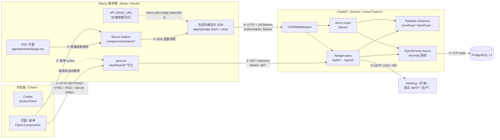
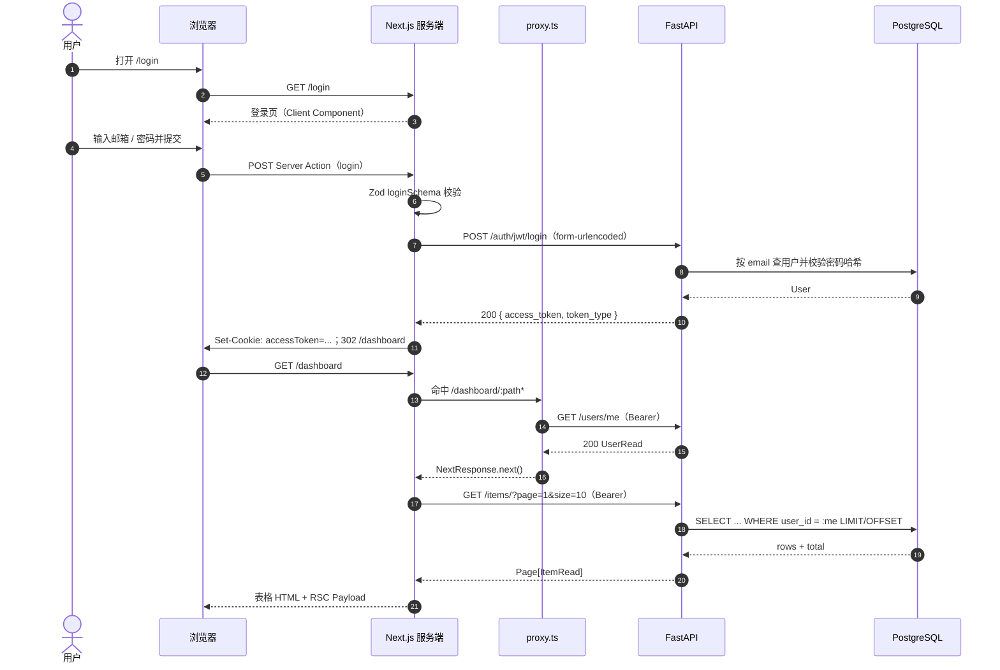
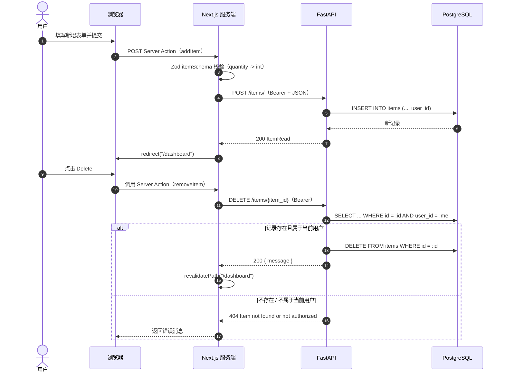
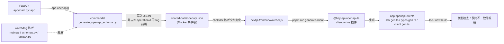
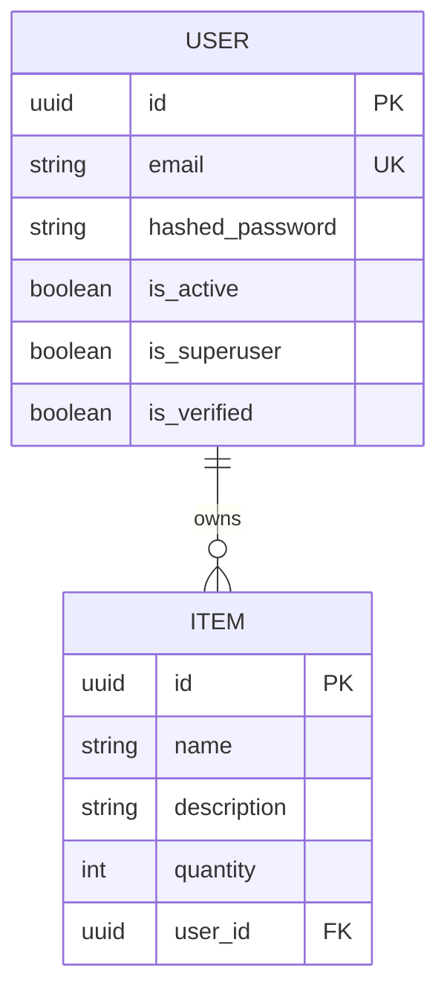
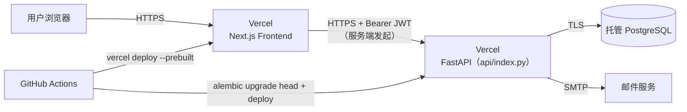

# Next.js + FastAPI 工程概要图（前台 → 后台全链路）

> 本文以当前仓库代码为准（Next.js 16 App Router + React 19 / FastAPI 0.115 + fastapi-users 13 / SQLAlchemy 2 async + asyncpg / PostgreSQL 17），
> 按“浏览器 → Next.js 服务端 → FastAPI → 数据库/邮件”的顺序，逐个环节说明：**怎么连接、用什么 API、起什么作用、优点是什么**。
>
> 约定：`SDK 函数名` 指 `app/openapi-client/sdk.gen.ts` 中自动生成的函数；`HTTP` 指 FastAPI 暴露的真实接口。

---

## 1. 结论先行

1. **浏览器不直连 FastAPI**。所有业务请求都由 Next.js 服务端（Server Action / RSC / proxy）发起，FastAPI 的地址 `API_BASE_URL` 只存在于服务端环境变量中。
2. **认证是 JWT + Cookie**。FastAPI 用 `fastapi-users` 的 `BearerTransport + JWTStrategy` 签发 HS256 Token；Next.js 把 Token 写进名为 `accessToken` 的 Cookie，后续服务端调用统一加 `Authorization: Bearer <token>`。
3. **前后端契约由 OpenAPI 自动生成**。FastAPI 的 `openapi.json` 经 `@hey-api/openapi-ts` 生成 TypeScript SDK + 类型，前端不手写接口类型。
4. **双层校验**：前端 Zod 做表单/运行时校验，后端 Pydantic + `fastapi-users` 做最终校验；前端守卫只是体验层，真正的权限边界在 FastAPI 的 `current_active_user` 依赖。
5. **数据按用户隔离**：`items` 路由的查询、创建、删除都带 `user_id == current_user.id` 条件。

---

## 2. 全景架构图



图中 ①~⑧ 就是下面逐环节说明的编号。

---

## 3. 运行时链路：逐环节拆解

### 3.1 页面渲染与路由守卫

| # | 环节 | 连接方式 | 使用的 API / 代码 | 作用 | 优点 |
|---|------|----------|-------------------|------|------|
| ① | 浏览器打开页面 | 浏览器 → Next.js，HTTP | App Router 页面（`app/page.tsx`、`app/login/page.tsx` 等）；RSC 默认在服务端渲染 | 返回首屏 HTML + RSC Payload；登录页等交互页为 Client Component | SSR/流式渲染，首屏快；服务端密钥、后端地址不进入浏览器 bundle |
| ② | 访问 `/dashboard/*` | Next.js `proxy.ts`（Next 16 中 middleware 的新名字）→ FastAPI，HTTP | `usersCurrentUser()` → `GET /users/me`，Header：`Authorization: Bearer <accessToken>` | 没有 Cookie 直接 302 到 `/login`；有 Cookie 则调用 `/users/me` 验证 Token 是否有效、用户是否 active | 统一入口拦截，页面不用重复写鉴权；Token 失效/被禁用会立刻踢回登录页 |

关键代码：

- `nextjs-frontend/proxy.ts`：`matcher: ["/dashboard/:path*"]`，只保护仪表盘。
- `fastapi_backend/app/main.py:45`：`get_users_router` 提供 `/users/me`。
- `fastapi_backend/app/users.py`：`current_active_user = fastapi_users.current_user(active=True)`。

> 注意：守卫是“体验层”。即使绕过 proxy 直接调接口，FastAPI 仍会用 `current_active_user` 拒绝未授权请求。

### 3.2 认证链路（登录 / 注册 / 找回密码 / 登出）

| # | 环节 | 连接方式 | 使用的 API / SDK | 作用 | 优点 |
|---|------|----------|------------------|------|------|
| ③ | 登录 | 表单 → Server Action（同源 POST）→ FastAPI | `login()` → `authJwtLogin()` → `POST /auth/jwt/login`，`Content-Type: application/x-www-form-urlencoded`，body：`username=邮箱&password=...` | Zod 校验 → 调后端验密码 → 拿到 `access_token` → 写入 `accessToken` Cookie → `redirect("/dashboard")` | 密码不落到 localStorage；浏览器只与同源 Next 通信；表单有服务端校验兜底 |
| ④ | 注册 | Server Action → FastAPI | `register()` → `registerRegister()` → `POST /auth/register`，JSON：`{ email, password }` | 创建用户；后端 `UserManager.validate_password` 强制 8 位、大写字母、特殊字符、不得包含邮箱 | 前后端同一套密码规则（Zod + Python 各实现一次），错误可回填表单 |
| ⑤ | 忘记密码 | Server Action → FastAPI → SMTP | `passwordReset()` → `resetForgotPassword()` → `POST /auth/forgot-password`，JSON：`{ email }` | fastapi-users 生成 reset token，`on_after_forgot_password` 调 `fastapi-mail` 发信 | 邮件模板 + Token 由成熟库处理；开发环境用 MailHog 直接看信 |
| ⑥ | 重置密码 | 邮件链接 → 确认页 → Server Action → FastAPI | 链接形如 `FRONTEND_URL/password-recovery/confirm?token=...`；提交后 `passwordResetConfirm()` → `resetResetPassword()` → `POST /auth/reset-password`，JSON：`{ token, password }` | 校验 reset token 并更新密码哈希 | Token 一次性、带签名；确认页还会校验两次密码一致 |
| ⑦ | 登出 | Server Action → FastAPI → 删除 Cookie | `logout()` → `authJwtLogout()` → `POST /auth/jwt/logout`，Bearer JWT；随后 `cookieStore.delete("accessToken")` | 通知后端登出并清 Cookie，跳回 `/login` | JWT 无状态，登出无需服务端 Session 存储；删除 Cookie 后浏览器立刻失去凭证 |

登录请求与响应示意：

```http
POST /auth/jwt/login HTTP/1.1
Content-Type: application/x-www-form-urlencoded

username=user@example.com&password=Secret123!
```

```json
{
  "access_token": "eyJhbGciOiJIUzI1NiIs...",
  "token_type": "bearer"
}
```

> 安全提示：JWT 是**无状态**的，`/auth/jwt/logout` 并不会让已签发的 Token 立刻失效；真正生效依赖“删除 Cookie + Token 1 小时过期（`ACCESS_TOKEN_EXPIRE_SECONDS=3600`）”。需要强制吊销时要额外做黑名单/版本号。

### 3.3 业务链路（Items 的查、增、删）

| # | 环节 | 连接方式 | 使用的 API / SDK | 作用 | 优点 |
|---|------|----------|------------------|------|------|
| ⑧ | 仪表盘列表 | RSC 页面 → Server Action → FastAPI | `dashboard/page.tsx` 读取 `searchParams.page/size` → `fetchItems(page, size)` → `readItem()` → `GET /items/?page=1&size=10`，Bearer JWT | 按 `user_id` 过滤 + 数据库分页，返回 `Page[ItemRead]`：`items / total / page / size / pages` | 分页在数据库完成，不把全量数据拉到前端；只返回当前用户数据；`total` 直接驱动分页组件 |
| ⑨ | 新增 Item | 表单 → Server Action → FastAPI | `addItem()` → Zod `itemSchema`（`quantity` 字符串转整数）→ `createItem()` → `POST /items/`，JSON：`{ name, description, quantity }` | 写入 `items` 表，`user_id` 由后端从 JWT 取，不信任前端传值 | 前端做格式校验，后端做类型/归属校验；成功后 `redirect("/dashboard")` |
| ⑩ | 删除 Item | 客户端按钮 → Server Action → FastAPI | `DeleteButton` → `removeItem(id)` → `deleteItem()` → `DELETE /items/{item_id}`，Bearer JWT | 先按 `id + user_id` 查记录，查不到返回 404，查到才删除；成功后 `revalidatePath("/dashboard")` | 防越权删除（别人的 item 查不到）；RSC 缓存精确失效，列表自动刷新 |

分页响应示意：

```json
{
  "items": [
    { "id": "uuid", "name": "Keyboard", "description": "Mechanical", "quantity": 2, "user_id": "uuid" }
  ],
  "total": 42,
  "page": 1,
  "size": 10,
  "pages": 5
}
```

对应后端实现：

- `fastapi_backend/app/routes/items.py`：`select(Item).filter(Item.user_id == user.id)` + `apaginate(...)`。
- `fastapi_backend/app/models.py`：`User 1—N Item`；ORM 关系配置 `cascade="all, delete-orphan"`，删除 User 对象时由 ORM 级联删除 Items。
- `nextjs-frontend/components/actions/items-action.ts`：三个 Server Action 统一从 Cookie 取 Token 并加 Bearer 头。

### 3.4 数据与邮件

| # | 环节 | 连接方式 | 使用的东西 | 作用 | 优点 |
|---|------|----------|------------|------|------|
| ⑪ | 数据持久化 | FastAPI → PostgreSQL，TCP 5432，`asyncpg` | SQLAlchemy 2 `AsyncSession` + `create_async_engine(..., poolclass=NullPool)`；Alembic 迁移 | 用户表、items 表的读写与事务 | 全异步，I/O 不阻塞事件循环；`NullPool` 适配 Vercel 这类 Serverless 环境，避免连接被实例长期占死 |
| ⑫ | 邮件发送 | FastAPI → SMTP（开发 MailHog 1025 / 生产真实 SMTP） | `fastapi-mail` 的 `FastMail` + Jinja 模板 `email_templates/password_reset.html` | 发送重置密码链接 | 模板与配置分离；开发期不依赖真实邮箱 |

---

## 4. 端到端时序图

### 4.1 登录 → 守卫 → 列表



### 4.2 新增与删除



---

## 5. API 清单（FastAPI 实际暴露）

| 方法 | 路径 | SDK 函数 | 认证 | 作用 |
|------|------|----------|------|------|
| POST | `/auth/jwt/login` | `authJwtLogin` | 否 | 邮箱 + 密码换取 JWT |
| POST | `/auth/jwt/logout` | `authJwtLogout` | Bearer | 登出（JWT 策略下为无状态操作） |
| POST | `/auth/register` | `registerRegister` | 否 | 注册 |
| POST | `/auth/forgot-password` | `resetForgotPassword` | 否 | 触发重置密码邮件 |
| POST | `/auth/reset-password` | `resetResetPassword` | 否 | 用 token 重置密码 |
| POST | `/auth/request-verify-token` | `verifyRequestToken` | 否 | 请求邮箱验证 token |
| POST | `/auth/verify` | `verifyVerify` | 否 | 验证邮箱 |
| GET | `/users/me` | `usersCurrentUser` | Bearer | 当前用户信息（proxy 用它校验 Token） |
| PATCH | `/users/me` | `usersPatchCurrentUser` | Bearer | 修改当前用户 |
| GET | `/users/{id}` | `usersUser` | Bearer | 按 ID 查用户 |
| PATCH | `/users/{id}` | `usersPatchUser` | Bearer | 按 ID 改用户 |
| DELETE | `/users/{id}` | `usersDeleteUser` | Bearer | 按 ID 删用户 |
| GET | `/items/` | `readItem` | Bearer | 当前用户 Items 分页列表 |
| POST | `/items/` | `createItem` | Bearer | 新增 Item |
| DELETE | `/items/{item_id}` | `deleteItem` | Bearer | 删除自己的 Item |

其他端点：

- `GET /openapi.json`：OpenAPI 契约（由 `OPENAPI_URL` 配置，可置空关闭）。
- `GET /docs`：Swagger UI（FastAPI 默认）。

---

## 6. OpenAPI 契约同步链路（开发期核心机制）

这是这个模板“前后端不脱节”的关键：**后端路由是唯一事实来源，前端 SDK 是生成物**。



具体步骤：

1. 修改 FastAPI 路由或 Pydantic Schema。
2. 后端 `watcher.py`（watchdog）监听到变化，执行 `uv run python -m commands.generate_openapi_schema`。
3. 生成 `openapi.json` 到 `OPENAPI_OUTPUT_FILE`；脚本会去掉 `operationId` 的 tag 前缀，让生成的函数名更干净。
4. 前端 `watcher.js`（chokidar）监听到 JSON 变化，执行 `pnpm run generate-client`。
5. `@hey-api/openapi-ts` 按 `openapi-ts.config.ts` 生成 SDK 与类型；`clientConfig.ts` 在运行时设置 `baseURL = API_BASE_URL`。
6. `next build` / `tsc` 做类型检查，接口字段改名、删除、类型变化都会在编译期暴露。

优点：

- **单一事实来源**：不用手写 `interface`，也不会出现“文档和实现两套”。
- **重构安全**：后端改字段，前端编译直接报错，而不是上线后 500。
- **开发期自动闭环**：保存 Python 文件 → 几秒后前端就能补全新函数。
- **可审阅**：`openapi.json` 可进 Git，Code Review 能看到契约 diff。

手动执行（不依赖 watcher）：

```bash
cd fastapi_backend && uv run python -m commands.generate_openapi_schema
cd nextjs-frontend && pnpm run generate-client
```

---

## 7. 数据模型



- `User` 继承 `SQLAlchemyBaseUserTableUUID`，由 fastapi-users 提供标准字段。
- `Item.user_id` 外键指向 `user.id`；ORM 关系配置 `cascade="all, delete-orphan"`，删用户会级联删 Items。
- 迁移用 Alembic：`alembic upgrade head`；本地/CI 用 `Base.metadata.create_all` 建测试库。

---

## 8. 这套架构的优点（按层归纳）

| 层面 | 优点 | 原因 |
|------|------|------|
| 安全 | 后端地址与 JWT 不进入浏览器 | `API_BASE_URL` 不是 `NEXT_PUBLIC_*`；所有调用在 Server Action / RSC / proxy 中完成 |
| 安全 | 权限有真正的兜底 | proxy 只做体验层，FastAPI 的 `current_active_user` + `user_id` 过滤才是边界 |
| 类型 | 端到端类型安全 | Pydantic → OpenAPI → TypeScript SDK；Zod 补运行时表单校验 |
| 性能 | 全异步 I/O | FastAPI async + SQLAlchemy async + asyncpg，数据库不阻塞事件循环 |
| 性能 | 数据库分页 | `fastapi-pagination` 的 `apaginate` 生成 LIMIT/OFFSET，避免全量传输 |
| 体验 | 表单渐进增强 | Server Action + `useActionState`，无手写 fetch，错误可回填 |
| 体验 | 自动刷新 | `revalidatePath` 精确失效 RSC 缓存，增删后列表立即更新 |
| 开发 | 契约自动同步 | watchdog + chokidar + openapi-ts，改后端即得前端类型 |
| 开发 | 开箱即用的认证 | fastapi-users 提供注册、登录、JWT、找回密码、邮箱验证 |
| 部署 | 双端可上 Vercel | 后端 `api/index.py` + `vercel.json` 路由；前端 Next 原生支持；本地 Docker Compose 一键起全栈 |
| 运维 | 环境一致 | Docker Compose 固定 PostgreSQL 17、MailHog、Python 3.12、Node 20 |

---

## 9. 现状中的风险点与改进建议

| 现状 | 风险 | 建议 |
|------|------|------|
| `proxy.ts` 每次进入 `/dashboard/*` 都请求 `GET /users/me` | 多一次网络往返，仪表盘首屏变慢；后端抖动会导致误跳登录 | 在 Next 侧本地验签（jose，共享 `ACCESS_SECRET_KEY`）或短 TTL 缓存校验结果 |
| JWT 无状态，登出只删 Cookie | 已泄露的 Token 在 1 小时内仍可用 | 缩短 TTL + Refresh Token；或维护 Token 版本号/黑名单 |
| `cookies().set("accessToken", ...)` 未显式设置安全属性 | 缺 `Secure` / `SameSite` / `HttpOnly` 声明 | 生产环境补 `httpOnly: true, secure: true, sameSite: "lax"` |
| `CORS_ORIGINS=["*"]` 且 `allow_credentials=True` | 生产环境过宽；浏览器对通配符 + 凭证有额外限制 | 生产改为具体前端域名，按环境注入 |
| Items 只有列表 / 新增 / 删除 | 无法编辑单条，UI 的 Edit 是 disabled | 补 `GET /items/{id}`、`PATCH /items/{id}`，再生成 SDK |
| `openapi.json` 可能落后于后端 | 前端 SDK 与后端不一致 | CI 中校验生成物 diff；或把生成步骤纳入构建 |
| 后端用 `NullPool` | 本地高并发时频繁建连，性能不如连接池 | Serverless 保持 `NullPool`；常驻服务可换 `AsyncAdaptedQueuePool` |
| 仪表盘 `logout` 按钮直接在 Server Component 上绑定 `onClick` | React Server Component 不允许事件处理器，可能运行时报错 | 抽成 Client Component，或用 `<form action={logout}>` |
| `fetchItems` 无 Token 时返回 `{ message }`，页面按分页结构强转 | 极端情况下页面显示空表/分页异常，而非跳登录 | 返回结构化错误或在页面判断后 `redirect("/login")` |

---

## 10. 目录速查

| 路径 | 职责 |
|------|------|
| `nextjs-frontend/app/page.tsx` | 首页 |
| `nextjs-frontend/app/login/page.tsx` | 登录页（Client Component） |
| `nextjs-frontend/app/register/page.tsx` | 注册页 |
| `nextjs-frontend/app/password-recovery/` | 忘记密码 / 重置密码确认 |
| `nextjs-frontend/app/dashboard/page.tsx` | 仪表盘（RSC，列表 + 分页） |
| `nextjs-frontend/proxy.ts` | `/dashboard/*` 路由守卫（调 `/users/me`） |
| `nextjs-frontend/components/actions/*.ts` | 所有 Server Actions（登录、注册、登出、Items、重置密码） |
| `nextjs-frontend/lib/definitions.ts` | Zod Schema（表单校验） |
| `nextjs-frontend/lib/clientConfig.ts` | 设置 SDK 的 `baseURL = API_BASE_URL` |
| `nextjs-frontend/app/openapi-client/` | 自动生成的 SDK / 类型（勿手改） |
| `nextjs-frontend/openapi-ts.config.ts` | openapi-ts 生成配置（client-axios 插件） |
| `nextjs-frontend/watcher.js` | 监听 `openapi.json`，自动重新生成客户端 |
| `fastapi_backend/app/main.py` | FastAPI 实例、CORS、路由注册、分页插件 |
| `fastapi_backend/app/users.py` | fastapi-users 配置、JWT 策略、密码策略、当前用户依赖 |
| `fastapi_backend/app/routes/items.py` | Items 列表 / 新增 / 删除 |
| `fastapi_backend/app/models.py` | SQLAlchemy 模型（User / Item） |
| `fastapi_backend/app/schemas.py` | Pydantic 请求/响应模型 |
| `fastapi_backend/app/database.py` | async engine、Session、`get_user_db` |
| `fastapi_backend/app/email.py` | 重置密码邮件 |
| `fastapi_backend/commands/generate_openapi_schema.py` | 导出 `openapi.json` |
| `fastapi_backend/watcher.py` | 监听后端代码，触发 mypy + 导出 OpenAPI |
| `docker-compose.yml` | backend / frontend / db / db_test / mailhog 编排 |

---

## 11. 部署拓扑



- 前端：`next build` → Vercel；`API_BASE_URL` 在部署时注入。
- 后端：`vercel.json` 把所有路径重写到 `api/index.py`；`vercel.prod.json` 在构建时执行 `alembic upgrade head`。
- 本地：`docker compose up` 启动 frontend:3000、backend:8000、PostgreSQL:5432、测试库:5433、MailHog UI:8025。
- 共享卷 `./local-shared-data` 让后端写 `openapi.json`、前端读同一个文件，形成代码生成闭环。

---

## 12. 一句话总结

**浏览器只和 Next.js 说话，Next.js 用 Server Action + 生成的类型化 SDK 带着 JWT 去和 FastAPI 说话，FastAPI 用 Pydantic 校验、用 SQLAlchemy async 访问 PostgreSQL；OpenAPI 把这条链路的两端在类型层面焊死。**
